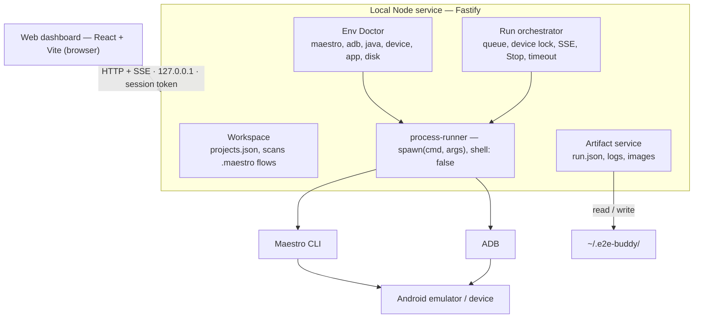

# E2E Buddy — Technical Specification

> Owner: Canh Vo · Last updated: 2026-10-14 · Status: Draft v0.1 · Source of truth for Phase 1 tickets

## 1. Overview

E2E Buddy is a web dashboard paired with a Node.js service that runs on the developer's machine. It lets you pick, run and debug Maestro flows on an Android emulator using a prebuilt APK, without typing terminal commands. This spec covers **Phase 1 (Functional MVP)** and leaves room for Phases 2–4.

### 1.1 Decisions made

| Area | Decision | Consequence |
| --- | --- | --- |
| Form factor | Web dashboard (React + Vite) + local Node.js service | No Electron/Tauri; open in a browser at `http://127.0.0.1:<port>` |
| App source | Prebuilt APK or an already-installed app only | No Gradle calls; no build cache management |
| Runner | Maestro CLI + Android only (emulator or device via ADB) | No multi-framework adapter layer; modules are still separated so they can be swapped later |
| Storage | JSON/JSONL files in `~/.e2e-buddy/` | No database; move to SQLite when history queries need it |
| AI | Not in Phase 1; optional in Phase 3 | The tool must be fully usable without an API key |

### 1.2 Phase 1 goals

- Add an RN project and automatically discover every flow in the `.maestro` directory.
- Check the environment (Maestro, ADB, device, app/APK) before running.
- Run one or several selected flows on one device and watch logs live.
- Stop a run safely, leaving no orphaned processes.
- Persist results, logs and artifacts for every run; view them again after a restart.

### 1.3 Out of scope for Phase 1

- Building the APK from source, iOS, Detox, parallel runs on multiple emulators.
- Visual YAML editor, cloud dashboard, login/permissions.
- AI diagnosis, flaky tracking, CI artifact import (Phases 2–4).
- Booting emulators (AVDs) automatically — Phase 1 only uses devices that are already running; this can be added in Phase 2.

## 2. System architecture

The browser only talks to the Node service over HTTP and SSE. Only the service may call Maestro, ADB or write files, and every external command goes through `process-runner`.



The run orchestrator is the core: it holds the device lock, drives each flow and emits events to the UI.

### 2.1 Stack

| Layer | Technology |
| --- | --- |
| Language | TypeScript 5 (`strict`), Node.js 20 LTS or later |
| Monorepo | pnpm workspaces |
| Server | Fastify, Zod, `fast-glob`, `yaml`, `fast-xml-parser` (JUnit) |
| Web | React 18, Vite, Tailwind CSS, TanStack Query, React Router, `@tanstack/react-virtual` |
| Testing | Vitest, fake binaries for `adb` and `maestro` |
| External | Maestro CLI, Android SDK platform-tools (ADB), Java (required by Maestro) |

### 2.2 Repository layout

```text
e2e-buddy/
├── apps/
│   ├── server/
│   │   └── src/
│   │       ├── api/              # routes, auth guard, SSE
│   │       ├── core/             # process-runner, config, storage
│   │       ├── workspace/        # project registry, flow discovery
│   │       ├── android/          # ADB adapter
│   │       ├── maestro/          # Maestro adapter
│   │       ├── runs/             # orchestrator, device lock
│   │       ├── doctor/
│   │       └── artifacts/
│   └── web/
│       └── src/
│           ├── pages/            # Workspace, RunConsole, History, Doctor, Settings
│           ├── components/
│           └── hooks/            # useRunEvents, useDevices
├── packages/
│   └── contracts/                # shared Zod schemas + types
├── test/fixtures/bin/            # fake adb and maestro for tests
└── docs/
```

Users start it with `pnpm start` (or `npx e2e-buddy` later). The server serves both the API and the built web app on one port, `4477` by default.

## 3. Data model

All types live in `packages/contracts` and are shared by server and web. Input is validated at the API boundary with Zod; TypeScript types are derived from the schemas (`z.infer`) so nothing is declared twice.

### 3.1 Core entities

```typescript
type ProjectId = string;   // nanoid
type RunId = string;       // "2026-10-14T09-30-12_ab12" — sortable by time

interface Project {
  id: ProjectId;
  name: string;
  rootPath: string;          // absolute, realpath-resolved
  maestroDir: string;        // relative to rootPath, default ".maestro"
  appId: string;             // e.g. "com.company.app"
  defaultApkPath?: string;   // absolute, must be inside allowedApkDirs
  env?: Record<string, string>; // passed to Maestro via -e KEY=VALUE
  createdAt: string;         // ISO 8601
}

interface TestFlow {
  id: string;                // hash of relativePath
  projectId: ProjectId;
  relativePath: string;      // e.g. "time-off/request-success.yaml"
  name: string;              // from the YAML `name` field or the file name
  tags: string[];            // from the `tags` field, if any
  isSubflow: boolean;        // inside a subflows/ folder or prefixed with _
}

interface Device {
  serial: string;            // e.g. "emulator-5554"
  state: "device" | "offline" | "unauthorized" | "unknown";
  bootCompleted: boolean;    // getprop sys.boot_completed === "1"
  model?: string;
  androidVersion?: string;
  isEmulator: boolean;
}
```

### 3.2 Run and FlowRun

A `TestRun` contains one or more `FlowRun`s. Phase 1 runs flows **sequentially**, one `maestro test` invocation per flow, so we know exactly which flow passed or failed and can file artifacts in the right place.

```typescript
type RunStatus =
  | "queued" | "preparing" | "running"
  | "passed" | "failed" | "cancelled" | "error";

type FlowStatus = "pending" | "running" | "passed" | "failed" | "skipped" | "cancelled" | "error";

interface TestRunRequest {
  projectId: ProjectId;
  flowIds: string[];         // >= 1
  deviceSerial: string;
  install?: { apkPath: string; reinstall: boolean }; // omitted = use the installed app
  stopOnFirstFailure: boolean;
  flowTimeoutMs: number;     // default 10 minutes
}

interface TestRun {
  id: RunId;
  request: TestRunRequest;
  status: RunStatus;
  createdAt: string;
  startedAt?: string;
  finishedAt?: string;
  flows: FlowRun[];
  error?: RunError;          // only when status = "error"
  env: RunEnvironmentSnapshot;
}

interface FlowRun {
  flowId: string;
  relativePath: string;
  status: FlowStatus;
  startedAt?: string;
  finishedAt?: string;
  exitCode?: number | null;  // null = killed by a signal
  signal?: string | null;
  failureSummary?: string;   // last error line parsed from output, if any
  artifacts: ArtifactRef[];
}

interface RunEnvironmentSnapshot {
  maestroVersion: string;
  adbVersion: string;
  device: Device;
  appVersionName?: string;   // from dumpsys package
  apkSha256?: string;
}

interface RunError {
  code: "ENV_NOT_READY" | "DEVICE_LOST" | "INSTALL_FAILED" | "RUNNER_CRASHED" | "TIMEOUT" | "INTERNAL";
  message: string;
  detail?: string;
}

interface ArtifactRef {
  kind: "screenshot" | "log" | "logcat" | "hierarchy" | "report" | "other";
  path: string;              // relative to the run dir
  sizeBytes: number;
}
```

### 3.3 Status rules

Status only moves forward: `queued → preparing → running → {passed | failed | cancelled | error}`. Any non-final status can move to `cancelled` (user pressed Stop) or `error` (environment/runner failure).

| Status | When |
| --- | --- |
| `passed` | Every FlowRun exited with code 0 |
| `failed` | At least one FlowRun exited non-zero because of the test (assertion, element not found…) while the runner itself was healthy |
| `error` | Could not run, or the runner broke: Maestro missing, device lost, APK install failed, timeout, server crash |
| `cancelled` | The user pressed Stop |

Never mark `passed` without exit code 0 from the Maestro process itself. When the server restarts and finds a run in a non-final status, it moves that run to `error` with code `RUNNER_CRASHED`.

Phase 1 tells `failed` from `error` with a heuristic: the server re-checks the device before and after each flow; if the device is gone or the output contains ADB/driver connection errors it is `error`, otherwise `failed`.

## 4. Storage

Data lives in `~/.e2e-buddy/` (overridable with the `E2E_BUDDY_HOME` environment variable), separate from the RN repo so git stays clean and Maestro's own output is never overwritten.

```text
~/.e2e-buddy/
├── config.json                  # port, allowedApkDirs, retention, tool paths
├── projects.json                # Project[]
└── runs/
    └── <run-id>/
        ├── run.json             # TestRun — rewritten on every status change
        ├── events.jsonl         # RunEvent, append-only
        ├── logcat.txt           # adb logcat for the whole run
        └── flows/
            └── <index>-<flow-slug>/
                ├── stdout.log
                ├── stderr.log
                ├── report.xml       # --format junit
                └── debug/           # Maestro --debug-output
```

### 4.1 Write rules

- `run.json` and `projects.json` are written **atomically**: write to a temp file in the same directory, then `rename`, so a crash never leaves a corrupt file.
- `events.jsonl` and log files are append-only via write streams; full logs are never held in memory.
- The server keeps at most the last 2,000 log lines per run in memory to serve newly connected clients; the rest is read from disk.
- The run list is built by scanning `runs/*/run.json`, sorted by directory name (run IDs start with a timestamp).

### 4.2 RunEvent

```typescript
type RunEvent =
  | { seq: number; ts: string; type: "status"; status: RunStatus }
  | { seq: number; ts: string; type: "flow-status"; flowIndex: number; status: FlowStatus }
  | { seq: number; ts: string; type: "log"; flowIndex: number; stream: "stdout" | "stderr"; line: string }
  | { seq: number; ts: string; type: "artifact"; flowIndex: number; artifact: ArtifactRef }
  | { seq: number; ts: string; type: "error"; error: RunError };
```

`seq` increases within each run. It is used as the SSE `id` so a client can reconnect with `Last-Event-ID` without losing logs.

### 4.3 Cleanup

By default the 50 most recent runs per project are kept (configurable). Cleanup runs at server start and after each run, and never deletes a run in progress.

## 5. Local API

The server uses Fastify, binds to `127.0.0.1` only, and prefixes routes with `/api`. Bodies are JSON validated with Zod. Errors share one shape: `{ error: { code, message, detail? } }`.

### 5.1 REST endpoints

| Method | Path | Description |
| --- | --- | --- |
| GET | `/api/health` | Server version, uptime |
| GET | `/api/doctor` | Checks Maestro, ADB, Java, disk space; returns `DoctorReport` |
| GET | `/api/projects` | List projects |
| POST | `/api/projects` | Add a project `{ name, rootPath, maestroDir?, appId, defaultApkPath? }` |
| PATCH | `/api/projects/:id` | Update configuration |
| DELETE | `/api/projects/:id` | Remove configuration (repo files untouched) |
| GET | `/api/projects/:id/flows` | Rescan and return `TestFlow[]` |
| GET | `/api/projects/:id/flows/:flowId/source` | YAML content (read-only) |
| GET | `/api/devices` | `Device[]` with boot state |
| GET | `/api/devices/:serial/app?appId=` | Whether the app is installed, versionName |
| POST | `/api/runs` | Create a run from `TestRunRequest`; returns `202` + `TestRun` |
| GET | `/api/runs?projectId=&status=&limit=` | Run history |
| GET | `/api/runs/:id` | Run details |
| POST | `/api/runs/:id/cancel` | Stop a run; idempotent |
| POST | `/api/runs/:id/rerun` | Create a new run; body `{ onlyFailed: boolean }` |
| GET | `/api/runs/:id/events` | SSE stream (see 5.2) |
| GET | `/api/runs/:id/artifacts/*` | Serve a file from the run directory (images, logs) |
| POST | `/api/runs/:id/reveal` | Open the run directory in Finder/Explorer |

`POST /api/runs` returns `409 DEVICE_BUSY` if the device already has a run, and `422 ENV_NOT_READY` if the quick pre-run check fails.

### 5.2 SSE — `/api/runs/:id/events`

- Each message: `id: <seq>`, `event: <type>`, `data: <RunEvent JSON>`.
- On connect, the server replays events with `seq > Last-Event-ID` (or the last 2,000 lines), then keeps streaming.
- Log lines are batched every 100 ms or 200 lines so the UI stays smooth.
- A `: ping` comment every 15 seconds keeps the connection alive.
- When the run ends, the server sends the final `status` event and closes the stream.

### 5.3 DoctorReport

```typescript
interface DoctorCheck {
  id: "maestro" | "adb" | "java" | "device" | "app" | "apk" | "disk";
  status: "ok" | "warn" | "fail";
  message: string;      // e.g. "Maestro 1.x.x at /Users/.../.maestro/bin/maestro"
  hint?: string;        // how to fix, e.g. "Install Maestro: curl -Ls https://get.maestro.mobile.dev | bash"
}

interface DoctorReport { checkedAt: string; checks: DoctorCheck[] }
```

## 6. Backend modules

Every external command goes through a single function, `exec(cmd, args, opts)`, in `process-runner`. It uses `spawn` with `shell: false`, a timeout and an `AbortSignal`. No other module may call `child_process` directly.

### 6.1 Workspace (project + flow discovery)

- When adding a project: `realpath` the `rootPath`, check that the directory exists and contains `maestroDir`.
- Suggest `appId` by reading `android/app/build.gradle(.kts)` (`applicationId`) or the `appId` header of the first flow. The user always confirms it.
- Scan `**/*.{yaml,yml}` inside `maestroDir` with `fast-glob`, skipping the root `config.yaml` (Maestro's workspace config) and `node_modules`.
- Parse the header (the first YAML document, before `---`) with the `yaml` library to read `name` and `tags`. Files that fail to parse are still listed, with a warning flag.
- Mark `isSubflow` when a file sits in a `subflows`/`shared` folder or its name starts with `_`. The UI hides subflows by default.

### 6.2 Android adapter (ADB)

| Operation | Command |
| --- | --- |
| List devices | `adb devices -l` |
| Check boot | `adb -s <serial> shell getprop sys.boot_completed` → `"1"` |
| Device info | `getprop ro.product.model`, `getprop ro.build.version.release` |
| App installed | `adb -s <serial> shell pm path <appId>` |
| App version | `adb -s <serial> shell dumpsys package <appId>` → parse `versionName` |
| Install APK | `adb -s <serial> install -r <apk>`; if `reinstall: true`, `uninstall <appId>` first |
| Logcat | `adb -s <serial> logcat -c`, then stream `logcat -v threadtime` to a file |

`adb` is resolved in this order: `config.json` → `$ANDROID_HOME/platform-tools` → `$ANDROID_SDK_ROOT/platform-tools` → `PATH`.

### 6.3 Maestro adapter

Each flow runs as one command, for example:

```bash
maestro --device <serial> test <flowAbsPath> \
  --format junit --output <flowDir>/report.xml \
  --debug-output <flowDir>/debug \
  -e KEY=VALUE
```

- `cwd` = the project's `rootPath`, so relative paths in `runFlow` behave as they do when run by hand.
- Set `MAESTRO_CLI_NO_ANALYTICS=1` and `MAESTRO_DISABLE_UPDATE_CHECK=true` in the child process env.
- Flag names and the debug folder layout change between Maestro versions. The adapter reads `maestro --version` at startup and keeps every version difference in one place. Step 0 of the plan confirms the flags against the version in use.
- After a flow finishes, scan `debug/` and `report.xml` to build `ArtifactRef[]` (`.png` → screenshot, `maestro.log` → log, `commands*.json` → report, hierarchy files → hierarchy).
- `failureSummary` comes from `<failure message>` in the JUnit report; otherwise the last error line of stderr.

### 6.4 Run orchestrator

An in-memory queue, at most one run per device. Steps of a run:

1. `queued`: create the run directory, write `run.json`, lock the device.
2. `preparing`: quick doctor (maestro, adb, device booted); install the APK if given; confirm the app is installed; capture `RunEnvironmentSnapshot`; clear and start logcat capture.
3. `running`: run each flow in turn, stream logs, re-check the device after each flow. With `stopOnFirstFailure`, mark the remaining flows `skipped`.
4. Finish: stop logcat, compute the overall status per section 3.3, write `run.json`, release the device lock in `finally`.

### 6.5 Stopping processes

Maestro runs through a shell script that launches a JVM, so killing the parent process is not enough.

- macOS/Linux: `spawn(..., { detached: true })` gives the child its own process group; Stop sends `SIGTERM` to the whole group (`process.kill(-pid)`), then `SIGKILL` if anything is still alive after 5 seconds.
- Windows (if supported later): `taskkill /pid <pid> /T /F`.
- When the server shuts down (`SIGINT`/`SIGTERM`), it cancels every active run the same way before exiting.
- Flow timeouts use the same mechanism and end as `error` with code `TIMEOUT`.

### 6.6 Artifact service

- Every requested path is resolved and checked to be inside the run directory (no `../`).
- Files are served with a `Content-Type` based on extension and `Content-Disposition: inline` for images and text.
- `reveal` uses `open <dir>` (macOS), `xdg-open <dir>` (Linux), `explorer <dir>` (Windows), always via `spawn` with an argument array.

## 7. Frontend

React 18 + Vite + TypeScript, Tailwind CSS, dark mode by default. Server state uses TanStack Query and routing uses React Router; no separate global store. Fastify serves the production build as static files, so users run a single command.

### 7.1 Phase 1 screens

| Route | Screen | Content |
| --- | --- | --- |
| `/` | Workspace | Project sidebar + searchable flow tree; right panel: device, APK, Run button |
| `/runs/:id` | Run Console | Status, flow list with per-flow status, live log, Stop/Rerun buttons |
| `/runs/:id` (finished) | Run Details | Same page plus Screenshots, Logs, Logcat, Environment tabs |
| `/history` | History | Run table, filter by project and status |
| `/doctor` | Environment Doctor | Checks with ok/warn/fail and fix hints |
| `/settings` | Settings | Tool paths, `allowedApkDirs`, retention |

### 7.2 Key interactions

- **Fastest path to a run:** pick a flow in the tree → `⌘/Ctrl + Enter` → Run Console opens.
- Select several flows with checkboxes or select a whole folder.
- The top status bar always shows a doctor summary (green/yellow/red); Run is disabled, with the reason, while any check is `fail`.
- Devices are polled every 5 seconds while the tab is open.
- The last selected device, APK and flows are remembered per project in `localStorage`.

### 7.3 Log viewer

- Virtualized list (`@tanstack/react-virtual`) to show tens of thousands of lines.
- Convert ANSI color codes to colors (`ansi-to-html` or similar); never render raw HTML from logs.
- Auto-scroll to the bottom; pause when the user scrolls up, with a “Jump to latest” button.
- Filter by flow, stdout/stderr and keyword.

### 7.4 SSE hook

`useRunEvents(runId)` opens an `EventSource`, folds events through a reducer and writes the new state into the TanStack Query cache (`['run', id]`). `EventSource` reconnects on its own with `Last-Event-ID`; the hook closes the connection once a final status arrives.

## 8. Security and process safety

The server can run commands on the developer's machine, so it must block both network access and unrelated web pages open in the browser (CSRF, DNS rebinding).

- **Bind:** `127.0.0.1` only. No option to bind `0.0.0.0` in Phase 1.
- **Host/Origin:** reject requests whose `Host` is not `127.0.0.1:<port>` / `localhost:<port>`. For state-changing requests, `Origin` must match.
- **Session token:** the server generates a random token at startup and prints `http://127.0.0.1:<port>/?t=<token>` to the terminal. The web app stores it in `sessionStorage` and sends it in the `X-E2E-Buddy-Token` header. SSE passes the token as a query parameter because `EventSource` cannot set headers.
- **No arbitrary shell:** the API accepts IDs only (project, flow, serial), never commands. The server builds argument arrays from validated data.
- **Input validation:** `serial` must appear in the latest `adb devices` output; `appId` must match the Android package regex; `flowIds` must belong to the project; env keys must match `[A-Z0-9_]+`.
- **Paths:** `rootPath` and APK paths go through `realpath`; the APK must sit inside `rootPath` or `allowedApkDirs` and end in `.apk`; artifact files must be inside the run directory.
- **Secrets:** project env values are masked (`***`) in logs and in `run.json` when the key contains `PASSWORD`, `TOKEN`, `SECRET` or `KEY`.
- **Nothing leaves the machine:** Phase 1 has no telemetry and makes no network calls.

## 9. Error handling and edge cases

| Situation | Detection | Result | UI |
| --- | --- | --- | --- |
| Maestro / ADB not installed | Doctor: binary not found | Run blocked | `fail` check with install command |
| No device | `adb devices` empty | Run blocked | “Start an emulator, then press Refresh” |
| Emulator still booting | `sys.boot_completed` ≠ 1 | Run blocked | “Booting…” state, updates on its own |
| Device `unauthorized` / `offline` | `adb devices` | Run blocked | Hint to accept USB debugging / restart adb |
| App not installed, no APK chosen | `pm path` empty | `422 ENV_NOT_READY` | Ask the user to pick an APK |
| APK missing / install fails | `stat` / `adb install` exit code | `error` · `INSTALL_FAILED` | Show adb output (e.g. `INSTALL_FAILED_UPDATE_INCOMPATIBLE`) |
| Device already running another run | Device lock | `409 DEVICE_BUSY` | Link to the active run |
| Flow fails an assertion | Non-zero exit, device still present | Flow `failed` | `failureSummary` + last screenshot |
| Device lost mid-run | Post-flow check | `error` · `DEVICE_LOST` | Remaining flows `skipped` |
| Flow runs too long | `flowTimeoutMs` | `error` · `TIMEOUT` | Elapsed time + log |
| User presses Stop | Cancel API | `cancelled` | Running flow `cancelled`, rest `skipped` |
| Server crashes / is killed | Unfinished run found at startup | `error` · `RUNNER_CRASHED` | Banner in History |
| YAML syntax error | Header parse fails | Still runnable | Warning icon next to the flow |
| Disk almost full | Doctor: < 1 GB free | Warning | `warn` check |

## 10. Testing and acceptance criteria

### 10.1 Test strategy

- **Unit (Vitest):** parsing `adb devices -l`, YAML headers and JUnit; overall status computation; safe-path checks; secret masking.
- **Integration with fake binaries:** `test/fixtures/bin/` holds fake `adb` and `maestro` scripts (print sample output, exit with a code set by env vars, or sleep to exercise Stop/timeout). The server points to them via `config.json`, so CI runs without an emulator.
- **Process tree test:** the fake `maestro` spawns a grandchild; after Stop, assert no PID is still alive.
- **Real smoke test (manual):** run on a real RN project with an emulator, following checklist 10.2.

Fake binaries exist only for tests. Production code has no demo mode and no fake results.

### 10.2 Phase 1 acceptance criteria

- [ ] Add an existing RN project; all flows in `.maestro` appear, subflows hidden.
- [ ] Doctor reports correctly with the emulator off, while booting, and with Maestro missing.
- [ ] Run one flow against the installed app without typing any terminal command besides starting the tool.
- [ ] Run one flow with a prebuilt APK install.
- [ ] Logs appear live, no more than 1 second behind the terminal.
- [ ] Run 3 flows in a row and see exactly which one failed.
- [ ] For a failed flow, view the screenshot, `maestro.log` and logcat of that exact run.
- [ ] Stop during a run leaves no orphaned `maestro`/java processes (checked with `ps`).
- [ ] Rerun only failed creates a new run with just the failed flows.
- [ ] History is still visible after restarting the server.
- [ ] Unplugging the device mid-run gives `error · DEVICE_LOST`, not `failed` or `passed`.
- [ ] API calls from another origin or without the token are rejected.

## 11. Phase 1 implementation plan

Each step must run and be verified before moving on. Total estimate is about 2–3 days, in line with the original plan.

| # | Step | Verification |
| --- | --- | --- |
| 0 | Spike: run `maestro test` by hand with `--debug-output`, `--format junit`, `--device` on the Maestro version in use; record the output layout | Notes in `docs/maestro-output.md` |
| 1 | Bootstrap pnpm monorepo: `apps/web`, `apps/server`, `packages/contracts`; ESLint, Prettier, Vitest, `strict: true` | `pnpm dev` opens the web app and `/api/health` responds |
| 2 | `process-runner` + Doctor (Maestro, ADB, Java, disk) | `/doctor` is accurate on a real machine |
| 3 | Project registry + flow discovery | Add a project, see the flow tree |
| 4 | Android adapter: devices, boot state, installed app | Device panel updates when the emulator starts/stops |
| 5 | Orchestrator runs one flow + `run.json` + SSE logs | Run one flow, watch live logs, result matches exit code |
| 6 | Stop + timeout + cleanup on server shutdown | Process tree test passes |
| 7 | Multiple flows in sequence, APK install, logcat, artifacts | Run Details shows screenshots + logs |
| 8 | History, rerun only failed, reveal folder | All criteria in 10.2 pass |
| 9 | Security (token, Host/Origin), README, `pnpm start` script | Security tests pass; someone else can install from the README |

The `runner-core`, `maestro-adapter` and `android-adapter` packages start as folders inside `apps/server/src/`. They move to `packages/` only when CI needs to reuse the runner (Phase 4).

## 12. Open questions and risks

### 12.1 Open questions

- [ ] Which Maestro version does the team use? Are the `--device`, `--debug-output`, `--format junit` flags named as assumed? (Step 0 answers this.)
- [ ] Do the flows rely on the workspace `config.yaml` (`flows`, `includeTags`, `excludeTags`)? If so, discovery should honor it.
- [ ] Which env vars do flows need (test accounts, backend URL)? Store them in `projects.json` or read the repo's `.env`?
- [ ] macOS only, or also Linux (self-hosted runner) and Windows?
- [ ] Does the monorepo hold several apps (several `appId`s, several `.maestro` folders)? If so, each app is its own project.

### 12.2 Risks

| Risk | Impact | Mitigation |
| --- | --- | --- |
| Maestro output/flags differ between versions | Artifacts not found, wrong parsing | Step 0; keep every difference in `maestro-adapter`; record `maestroVersion` on each run |
| Maestro's JVM survives Stop | Emulator stays busy, next run fails | Kill the whole process group; process tree test |
| Maestro self-updates or prompts interactively | Run hangs | Disable update check/analytics via env; stdin = `ignore`; timeout |
| Wrong `failed` / `error` classification | Users stop trusting results | Simple heuristic; always show raw output next to the label |
| Very large logcat | Disk fills up, UI slows | Capture only during the run; cap at 50 MB per run; virtualized viewer |
| An unrelated web page calls the local API | Unwanted commands run | Session token + Host/Origin checks + no shell endpoint |
